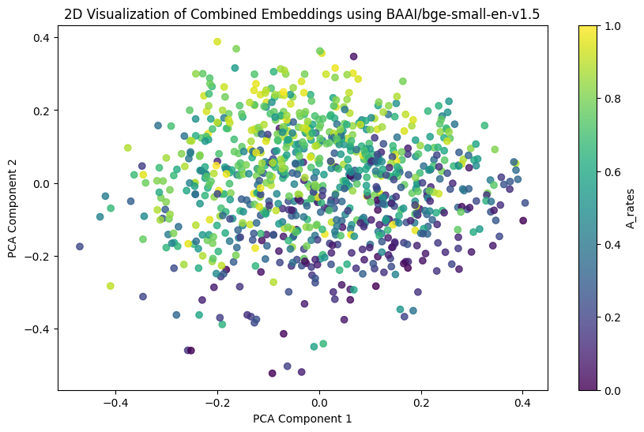
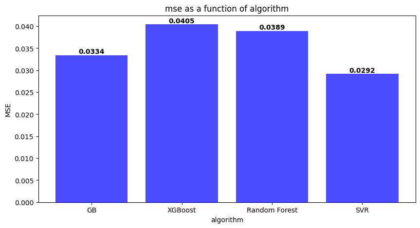

# Predicting Human Choices from Verbal Descriptions of Gambles

Final project (prediction task) for **Behavioral Economics (00960606)**.
**Author:** Omri Savir

This project predicts the **proportion of people who choose option A over option B** in binary choice problems. Participants chose between options based on their actual numerical payoff distributions, but the model only sees **verbal descriptions** of those options, not the underlying numbers. The solution combines **text embeddings (NLP)** and **machine learning** with a simple **behavioral-economics feature** that captures perceived risk.

---

## Motivation

Plonsky et al. (2019) show that combining machine learning with behavioral theories predicts human decisions better than either approach alone. Human choices are shaped by cognitive biases, framing effects and loss aversion, not only by expected value. This project follows that idea: language-model embeddings capture what each description says, and explicit risk-related features add a behavioral signal.

## Data

> **Disclaimer:** the dataset was provided as part of the course and is **not publicly available**. It is therefore **not included** in this repository, and the notebook cannot be run without it.

- **Training set (`train_problems.csv`):** 900 binary choice problems. Each problem contains:
  - `problem_num`: problem ID
  - `A`, `B`: free-text descriptions of the two options. For example: *"This option stands out with a lower risk profile…"* or *"Go with this if you're aiming for a chance at…"*
  - `A_rates`: the proportion of participants who chose option A (the target, between 0 and 1)
- **Test set (`test_problems.csv`):** 100 problems with the same text fields and no labels.
- **Output (`prediction.csv`, included):** the predicted `A_rates` for each of the 100 test problems.

## Method

### 1. Text embeddings

Seven pre-trained sentence-embedding models were compared:

- `sentence-transformers/all-MiniLM-L6-v2`
- `sentence-transformers/all-MiniLM-L12-v2`
- `sentence-transformers/paraphrase-multilingual-MiniLM-L12-v2`
- `intfloat/multilingual-e5-small`
- `BAAI/bge-small-en-v1.5`
- `thenlper/gte-small`
- `sentence-transformers/multi-qa-MiniLM-L6-cos-v1`

For each model, the A and B descriptions were embedded and concatenated, then projected to 2D with PCA and colored by `A_rates`. Based on this visual inspection, **`BAAI/bge-small-en-v1.5`** gave the clearest separation and was selected.



**Problem representation:** prompts such as *"I prefer [A] over [B]"* were also tried. The final approach embeds each option separately and concatenates the two vectors. With 384 dimensions per option, each problem becomes a 768-dimensional vector. This lets the model learn the characteristics of each option on its own before combining them.

### 2. Symmetry augmentation

Every training problem is duplicated with options A and B swapped, and the target becomes `1 − A_rates`. This doubles the training data and teaches the model that the order of the options is arbitrary. Within cross-validation, augmentation is applied to the training folds only.

### 3. Behavioral feature: perceived risk

Loss and risk aversion suggest that options described as riskier are chosen less often. To capture this, TF-IDF scores were computed for risk-related words, separately for the A and B texts. The words are **`risk`, `loss`, `losses` and `bet`**, chosen from the 100 most frequent words across the descriptions to avoid overfitting. These eight features are added to the embedding vector.

### 4. Model selection

Four regressors were compared: **Gradient Boosting, XGBoost, Random Forest and SVR**. The comparison used **9-fold cross-validation** with MSE as the metric. Each fold holds 100 validation problems and 800 training problems, which become 1,600 rows after augmentation.

Average validation MSE across the 9 folds:

| Algorithm | Mean CV MSE |
|---|---|
| **SVR** | **0.0292** |
| Gradient Boosting | 0.0334 |
| Random Forest | 0.0389 |
| XGBoost | 0.0405 |



- **SVR** achieved the lowest average validation error and was selected. In the notebook's comparison it already runs with its tuned hyperparameters, while the other models use default settings.
- The SVR hyperparameters were tuned with the same 9-fold scheme. The final values are `C=2` and `epsilon=0.01`, with all other parameters at their defaults.

### 5. Final prediction

The final SVR is trained on the full augmented training set (1,800 rows). Predictions for the test set are clipped to [0, 1] and saved to `prediction.csv`.

## Repository contents

```
behavioural_economicies_project.ipynb   # full notebook (with outputs)
prediction.csv                          # predictions for the 100 test problems
images/                                 # figures used in this README
```

**Notebook sections:**

1. Loading the data and symmetry augmentation
2. Word-frequency exploration with TF-IDF
3. Comparison of the embedding models with 2D PCA plots
4. Feature construction: embeddings plus risk-word TF-IDF
5. 9-fold cross-validation across the four algorithms
6. Training the final model and generating test predictions

## How to run

The notebook was developed in **Google Colab**. Because the dataset is not public, running it requires access to the course data files (`train_problems.csv`, `test_problems.csv`) in the working directory.

**Main dependencies:** Python 3, pandas, numpy, scikit-learn, xgboost, sentence-transformers, matplotlib.

## References

- Plonsky, O., Apel, R., Ert, E., Tennenholtz, M., Bourgin, D., Peterson, J. C., ... & Erev, I. (2019). *Predicting human decisions with behavioral theories and machine learning*. arXiv preprint arXiv:1904.06866.
- Xiao, S., Liu, Z., Zhang, P., Muennighoff, N., Lian, D., & Nie, J.-Y. (2024). C-Pack: Packed resources for general Chinese embeddings. In *Proceedings of the 47th International ACM SIGIR Conference on Research and Development in Information Retrieval* (pp. 641–649).
- [BAAI/bge-small-en-v1.5 model card](https://huggingface.co/BAAI/bge-small-en-v1.5), Hugging Face.
